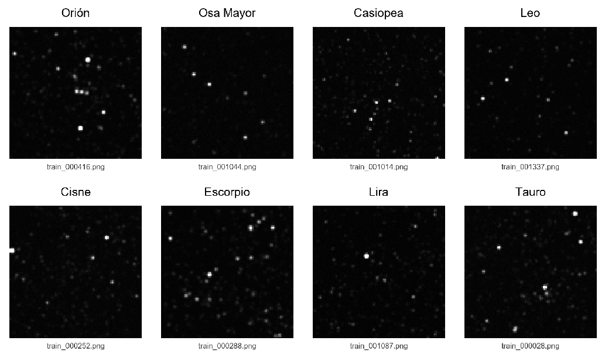

# Práctica 1

URJC · Máster Univ. en Visión Artificial · Reconocimiento de Patrones · Curso 2026/27

## 1. Enunciado

Un CubeSat que pierde su orientación, por ejemplo tras el impacto de un fragmento de basura espacial, puede utilizar imágenes del cielo como ayuda para orientarse de nuevo. En esta práctica abordaremos un primer paso de ese problema: reconocer si la cámara está viendo una parte de la constelación de Orión.

Para ello, construiréis un proyecto de aprendizaje automático, al que denominaremos clasificador, que prediga si una imagen de un campo estelar contiene el patrón de referencia de Orión. La visualización interactiva `Simulacion_P1.html` ilustra esta situación. La detección de Orión, por sí sola, no determina la orientación completa ni la posición orbital del satélite.

El proyecto debe permitir procesar ejemplos nuevos con una interfaz mínima: proporcionar una carpeta de imágenes e invocar un script de Python para generar un fichero de etiquetas estimadas.

En esta práctica se proporcionan las imágenes: la extracción de características forma parte del trabajo.



*Figura 1: Ejemplos de las ocho constelaciones presentes en el conjunto de datos.*

## 2. Descripción del conjunto de datos

### 2.1. Imágenes

El archivo `Datos_P1.zip` contiene imágenes PNG de 96×96 píxeles en escala de grises:

- `train/imagenes/`: 2.000 imágenes de entrenamiento.
- `test/imagenes/`: 1.000 imágenes de test para la evaluación final.
- `referencia_orion.png`: imagen de referencia con las siete estrellas principales.
- `Y_train.csv`: etiquetas del entrenamiento.

Las imágenes son sintéticas, generadas a partir de coordenadas estelares reales. Presentan variaciones de giro, desplazamiento, recorte, exposición y ruido. Además de Orión, incluyen regiones de Osa Mayor, Casiopea, Leo, Cisne, Escorpio, Lira y Tauro. No contienen nombres ni líneas de unión entre estrellas. Es importante inspeccionar y entender los datos antes de programar.

### 2.2. Etiquetas

`Y_train.csv` tiene cabecera `id,orion` y una fila por imagen. El identificador es su nombre de fichero, incluida la extensión `.png`. La etiqueta es 1 cuando el centro de al menos cuatro de las siete estrellas principales de Orión está dentro de la imagen, y 0 en caso contrario. Las siete estrellas son Betelgeuse, Bellatrix, Rigel, Saiph, Alnitak, Alnilam y Mintaka. Un negativo puede contener hasta tres de ellas. El entrenamiento contiene 250 positivos y 1.750 negativos; las clases están desequilibradas.

No se proporcionan las etiquetas de test: vuestra tarea es predecirlas. Los identificadores sirven para asociar imágenes y etiquetas, no como características.

## 3. Condiciones del modelo

Sólo se pueden utilizar los modelos de aprendizaje incluidos en Scikit-Learn. Se permiten bibliotecas de procesamiento de imágenes para extraer características.

Se puede utilizar el código proporcionado en clase. El código de terceros debe indicarse con el comentario `#** código de terceros ! **` y su procedencia.

El preprocesamiento, la selección de características y el ajuste del modelo deben validarse utilizando únicamente el entrenamiento. No se puede ajustar ninguna etapa con las imágenes de test ni utilizar sus etiquetas para tomar decisiones (etiquetas que no se proporcionan pero que tampoco se deben estimar con otros modelos).

Comparad diferentes procesamientos y modelos usando las mismas particiones de validación. Conservad junto al modelo las transformaciones necesarias para inferir.

## 4. Entrega de predicciones

Las predicciones se entregarán por separado, en la actividad del aula virtual «Práctica 1 – Predicciones», dentro del plazo indicado en esa actividad. Se subirá un único fichero CSV por pareja, sin comprimir:

`RP_P1_GXX_predicciones.csv`

GXX es el identificador de grupo asignado en el aula virtual (por ejemplo, G01). Debe usarse el mismo identificador en las dos entregas.

El formato obligatorio es CSV en UTF-8, separado por comas, con cabecera exacta `id,orion`. Debe contener exactamente una predicción para cada una de las 1.000 imágenes de test, sin identificadores repetidos, ausentes ni adicionales. Sólo se admiten etiquetas enteras 0 y 1, sin probabilidades, sin columna de índice y sin rutas delante del nombre de imagen. Por ejemplo (las etiquetas siguientes sólo ilustran el formato):

```csv
id,orion
test_000001.png,0
test_000002.png,1
```

La corrección asociará las predicciones por identificador; el orden de las filas no afecta al resultado. Se utilizará como métrica principal la exactitud equilibrada:

$$
\text{balanced accuracy} = \frac{1}{2}\left(\frac{VP}{VP + FN} + \frac{VN}{VN + FP}\right).
$$

Así, las dos clases tienen el mismo peso aunque sus tamaños sean distintos. Se analizará también la matriz de confusión. La calidad predictiva por sí sola no determina la nota: se valoran el trabajo propio y la corrección del procedimiento.

## 5. Condiciones de entrega de la memoria y el código

El equipo debe estar formado por dos alumnos. Basta con que uno realice las dos entregas, exclusivamente a través del aula virtual.

En la actividad «Práctica 1 – Memoria y código» se entregará `RP_P1_GXX_memoria_codigo.zip`, dentro del plazo que indique esa actividad.

El ZIP tendrá los siguientes archivos en su raíz:

- `nombres.txt`: identificador del grupo y nombres completos de ambos alumnos.
- `RP_P1_GXX_memoria.pdf`: memoria de un máximo de tres páginas más portada, con los nombres y el identificador del grupo en la portada.
- `entrenar.py`: código para entrenar el clasificador.
- `predecir.py`: código distinto para cargar el modelo y hacer inferencia.
- `README.txt`: instrucciones de ejecución si fuese necesario.

Incluid los módulos auxiliares que necesiten los scripts. No incluyáis los datos, entornos virtuales ni las predicciones: el CSV se entrega en la actividad separada.

La memoria debe explicar las características utilizadas, el proceso de validación, los modelos ensayados, los resultados obtenidos y la elección del modelo final.

El siguiente comando debe funcionar desde la raíz del ZIP descomprimido, adaptando las rutas de los datos:

```sh
python predecir.py --imagenes RUTA/test/imagenes --salida RP_P1_G01_predicciones.csv
```

Es decir, las predicciones generadas deben ser reproducibles.

## 6. Checklist

Se valorará cumplir todos los requisitos de entrega. Antes de enviar, comprobad:

- [ ] CSV con nombre de grupo, cabecera correcta y una etiqueta por imagen, enviado por separado.
- [ ] ZIP con el mismo identificador de grupo y `nombres.txt`.
- [ ] Memoria en PDF, con los nombres en la portada y dentro del límite de páginas.
- [ ] Código comentado, con un script de entrenamiento y otro de inferencia.
- [ ] Entrenamiento y validación correctos, sin utilizar el test para ajustar el sistema.
- [ ] Inferencia comprobada desde el ZIP descomprimido.

## 7. Recomendaciones

Utiliza un IDE para programar y depurar. Los cuadernos pueden ayudar a explorar, pero la entrega debe incluir los scripts ejecutables solicitados.

Prueba diferentes procesamientos y representaciones de las imágenes.

Prueba diferentes modelos y realiza validaciones cruzadas estratificadas.

Ten en cuenta el desequilibrio de clases y analiza los errores de ambas clases.

En la memoria, sé conciso: resume los experimentos e incluye figuras o tablas cuando ayuden a entender los resultados. Amplía los detalles en los comentarios del código.
