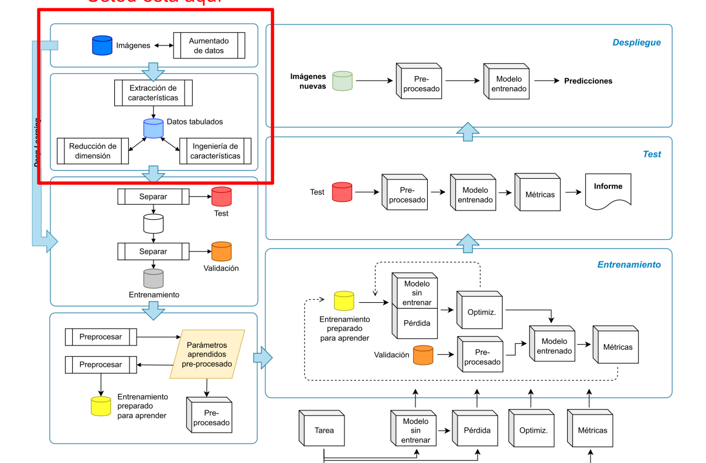

# Hoja de ruta de la práctica 1

**Versión inicial.** Clasificación binaria de imágenes de campos estelares. Una imagen es positiva si contiene el centro de al menos cuatro de las siete estrellas principales de Orión. Los modelos serán de scikit-learn y la extracción de características forma parte del trabajo. [Enunciado de la práctica](Enunciado.md)

La zona resaltada del esquema marca el punto de partida. En esta práctica la separación de test ya viene dada. Las 2.000 imágenes etiquetadas sirven para entrenar y validar, y las 1.000 imágenes de test se reservan para generar el CSV final.

## 1. Inspeccionar el entrenamiento y extraer características

- Revisar positivos y negativos de entrenamiento para entender cómo afectan el giro, el desplazamiento, el recorte, la exposición y el ruido. Usar el identificador solo para asociar cada imagen con su etiqueta.
- Construir una primera representación con píxeles normalizados y reducidos de resolución para tener una referencia experimental.
- Probar una representación geométrica. Detectar puntos brillantes, estimar sus centros y resumir la distribución de distancias entre pares y ángulos entre tríos. Las distancias normalizadas y los ángulos pueden ayudar a reconocer el patrón con giros y cambios de escala. El recorte puede eliminar estrellas, así que conviene probar descriptores que admitan un número variable de puntos.
- Comparar la aportación del escalado, la selección de variables y PCA según la representación. Si ensayamos aumento de datos, aplicarlo solo dentro de la parte de entrenamiento de cada partición. Evitar recortes o desplazamientos que puedan sacar estrellas del encuadre y cambiar la etiqueta.

Cuadernos para esta fase: `01_extraccion_caracteristicas.ipynb`, `02_seleccion_filtrado.ipynb`, `03_PCA.ipynb` y `05_pipeline_datos.ipynb`.

## 2. Fijar el protocolo de validación

- Empezar con cinco particiones estratificadas de entrenamiento mediante `StratifiedKFold` y una semilla fija. Reutilizar las mismas particiones en todas las comparaciones.
- Encapsular las transformaciones y el clasificador en un `Pipeline`. Ajustar el escalado, la selección de variables y PCA exclusivamente con la parte de entrenamiento de cada partición.
- Registrar la exactitud equilibrada media y su dispersión entre particiones. Añadir la matriz de confusión y revisar ejemplos de falsos positivos y falsos negativos. Hay 250 positivos y 1.750 negativos.
- Si se realiza una búsqueda extensa de hiperparámetros, usar validación interna para el ajuste y las particiones externas para comparar las configuraciones seleccionadas. Los datos de test quedan reservados hasta cerrar el modelo.

Cuadernos para esta fase: `05_pipeline_datos.ipynb` y `08_proy_Kfold.ipynb`.

## 3. Comparar modelos individuales

| Prioridad | Modelo | Experimento inicial | Cuaderno de clase |
|---|---|---|---|
| 1 | SVM lineal y SVM con kernels RBF y polinómico | Comparar los tres con las mismas características. Ajustar `C`, `gamma` donde aplique y el grado en el kernel polinómico. Probar `class_weight="balanced"` para medir el efecto del desequilibrio. | `06_clf_lin_bin.ipynb`, `09_nolin_svm.ipynb` |
| 2 | Perceptrón multicapa (`MLPClassifier`) | Usar características escaladas y probar redes pequeñas de una o dos capas ocultas y distintos niveles de regularización. | `11_nolin_MLP.ipynb` |
| 3 | Mezclas de gaussianas (`GaussianMixture`), exploratorio | Ajustar una mezcla por clase sobre características de baja dimensión. Comparar la log-verosimilitud por clase empezando con pocas componentes y covarianza diagonal. Vigilar la estabilidad en la clase positiva. | `12_nolin_GMM.ipynb` |

## 4. Probar conjuntos de modelos

- **Votación.** Combinar los mejores modelos individuales si cometen errores distintos. Empezar con etiquetas y probar votación por probabilidades si se pueden calibrar dentro de la validación.
- **Bagging y Random Forest.** Comparar bagging de árboles con Random Forest como referencia de conjuntos de árboles.
- **AdaBoost y Gradient Boosting.** Ensayar ambos métodos con árboles poco profundos y comparar su exactitud equilibrada, dispersión y errores con los mejores modelos individuales.

Cuadernos para esta fase: `13_Voting.ipynb`, `14_Bagging.ipynb`, `15_AdaBoost.ipynb`, `16_RandomForest.ipynb` y `16_gradient_boosting.ipynb`.

## 5. Cerrar el modelo y preparar la entrega

1. Elegir la representación y el modelo a partir de la validación. Reentrenar con las 2.000 imágenes etiquetadas y conservar el modelo junto con las transformaciones que necesita para inferir.
2. Implementar `entrenar.py` y `predecir.py`. Marcar el código de terceros con `#** código de terceros ! **` y su procedencia.
3. Desde la raíz del ZIP descomprimido, comprobar que funciona `python predecir.py --imagenes RUTA/test/imagenes --salida RP_P1_GXX_predicciones.csv`. Verificar UTF-8, cabecera `id,orion`, 1.000 identificadores únicos que coincidan con los nombres de los PNG y etiquetas enteras 0 o 1.
4. Completar la memoria con las características, el protocolo de validación, los modelos, los resultados y la elección final. El máximo es de tres páginas más la portada con el grupo y los dos nombres.
5. Entregar el CSV por separado. Preparar `RP_P1_GXX_memoria_codigo.zip` con `nombres.txt`, `RP_P1_GXX_memoria.pdf`, los dos scripts, sus módulos auxiliares y `README.txt` si hace falta. Excluir los datos, los entornos virtuales y el CSV de predicciones. [Requisitos de entrega](Enunciado.md#5-condiciones-de-entrega-de-la-memoria-y-el-código)
